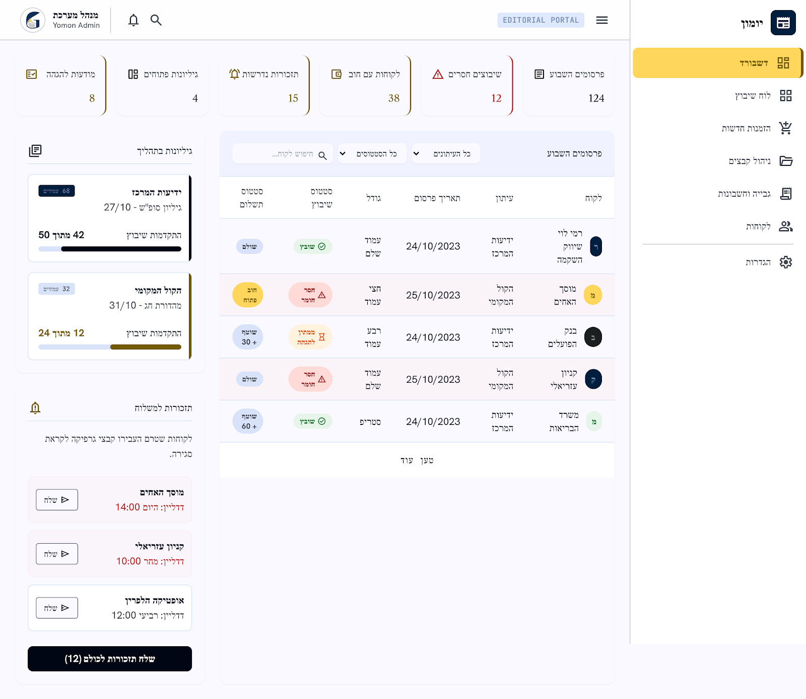

# מסך 01 — דשבורד

|             |                                                                   |
| ----------- | ----------------------------------------------------------------- |
| **נכסים**   | `../assets/01-dashboard.png` · `../assets/01-dashboard.html`      |
| **נתיב**    | `dashboard`                                                       |
| **מכסה**    | US-001, FR-20, FR-11                                              |
| **תפקידים** | Admin, Sales, Accounting (Designer — ללא עמודת סטטוס תשלום, FR-8) |

---

## מבנה

### שורת KPI (6 כרטיסים)

מימין לשמאל, כל אחד עם גבול צדדי בצבע סמנטי:

| תווית           | ערך לדוגמה | צבע       | מקור הנתון                                            |
| --------------- | ---------- | --------- | ----------------------------------------------------- |
| פרסומים השבוע   | 124        | ניטרלי    | `Publication` בטווח השבוע                             |
| שיבוצים חסרים   | 12         | error     | `placement_status = not_placed`                       |
| לקוחות עם חוב   | 38         | ניטרלי    | `payment_status IN (debt, partially_paid)`            |
| תזכורות נדרשות  | 15         | secondary | `Reminder.status = needed`                            |
| גיליונות פתוחים | 4          | ניטרלי    | `Issue.status IN (draft, in_layout, ready_for_print)` |
| מודעות להגהה    | 8          | secondary | ⚠️ ראה פערים                                          |

### עמודה ימנית (צרה) — שני ווידג'טים

**גיליונות בתהליך** — כרטיס לכל גיליון עם גבול צדדי עבה, ובתוכו: שם עיתון (bold), badge מספר עמודים, תיאור הגיליון (`גיליון סופ״ש – 27/10`), ושורת התקדמות שיבוץ `42 מתוך 50` עם פס התקדמות. הגיליון הדחוף בגבול כהה, השני בגבול זהב.

**תזכורות למשלוח** — כותרת + משפט הסבר, ואז כרטיס לכל תזכורת: שם לקוח (bold), דדליין בצבע error (`דדליין: היום 14:00`), וכפתור קטן `שלח` עם אייקון. בתחתית כפתור primary ברוחב מלא: **שלח תזכורות לכולם (12)**.

> FR-11 קובע שב-MVP תזכורות **אינן נשלחות אוטומטית** — משתמש פנימי מאשר שליחה. העיצוב תואם: יש כפתורי שליחה ידניים מפורשים. ✅

### עמודה שמאלית (רחבה) — טבלת "פרסומים השבוע"

סרגל מסננים מעל הטבלה: כותרת "פרסומים השבוע", dropdown "כל העיתונים", dropdown "כל הסטטוסים", שדה חיפוש "חיפוש לקוח…".

עמודות: **לקוח** (אווטאר + שם) · **עיתון** · **תאריך פרסום** · **גודל** · **סטטוס שיבוץ** · **סטטוס תשלום**

שורות עם בעיה מקבלות רקע אדמדם עדין. בתחתית — "טען עוד".

---

## רעש של Stitch — לא לממש

- **"מודעות להגהה" / "ממתין להגהה"** — מצב הגהה לא קיים ב-`prd.md` ולא ב-`erd.md`. הכרטיס השישי והסטטוס הזה יוחלפו במדד אמיתי מתוך FR-20 (למשל "פרסומים חסרי מודעה").

## פערים אמיתיים מול האפיון — להשלים

1. **חסרות עמודות בטבלה.** US-001 דורש שכל שורה תציג לקוח, עיתון, תאריך, גודל, **מקור הפרסום**, **סטטוס פרסום**, סטטוס שיבוץ, **סטטוס מודעה** וסטטוס תשלום. בעיצוב יש רק שיבוץ ותשלום.
2. **חסרים מסננים.** US-001 דורש סינון לפי עיתון, **תאריך**, **לקוח** וסטטוס. בעיצוב יש חיפוש לקוח חופשי בלבד, אין בורר טווח תאריכים.
3. **קישוריות מכרטיסי KPI.** FR-20 ו-US-001 דורשים שכל אזור בדשבורד יוביל לרשימה מסוננת. אין אינדיקציה שהכרטיסים לחיצים.
4. **תצוגת Designer.** FR-8: גרפיקאית לא רואה נתוני תשלום כברירת מחדל. צריך להגדיר איך נראים הטבלה ושורת ה-KPI בלעדיהם.
5. **מצב ריק** — איך נראה הדשבורד לעסק חדש בלי נתונים.
