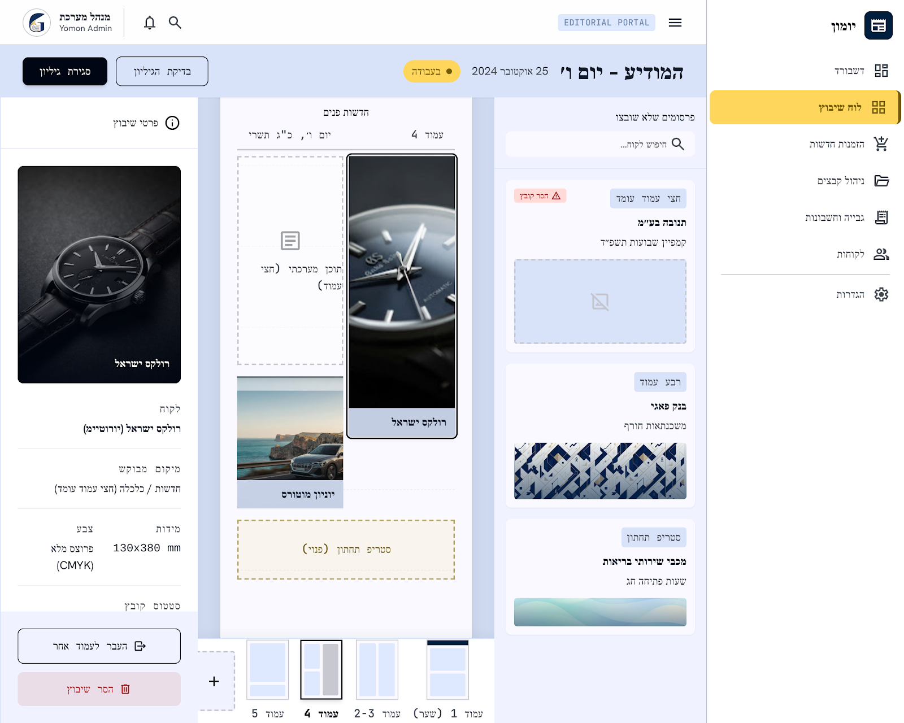

# מסך 02 — לוח שיבוץ גיליון

|             |                                                                    |
| ----------- | ------------------------------------------------------------------ |
| **נכסים**   | `../assets/02-layout-board.png` · `../assets/02-layout-board.html` |
| **נתיב**    | `layout-board`                                                     |
| **מכסה**    | US-007, US-008 (חלקית), FR-6, FR-14, FR-16                         |
| **תפקידים** | Designer, Admin                                                    |

**זה המסך המורכב ביותר במערכת ולב המוצר.** הוא ראוי לתשומת הלב הרבה ביותר במימוש.

---

## מבנה — שלושה פאנלים + סרגל

### סרגל עליון

מימין: שם גיליון ב-`headline-lg` (**המודיע – יום ו׳**), תאריך (`25 אוקטובר 2024`), ו-badge סטטוס זהב (`● בעבודה` = `in_layout`).
משמאל: `בדיקת הגיליון` (secondary) + `סגירת גיליון` (primary).

### פאנל ימני — "פרסומים שלא שובצו"

שדה חיפוש לקוח, ואז רשימת כרטיסים נגררים. כל כרטיס:

- badge צורת פרסום בפינה (`חצי עמוד עומד`, `רבע עמוד`, `סטריף תחתון`)
- שם לקוח (bold) + תיאור הקמפיין
- תמונה ממוזערת של המודעה

כרטיס ללא קובץ מקבל badge אדום **`⚠ חסר קובץ`** ובמקום תמונה — מלבן מקווקו עם אייקון תמונה חסרה. תואם ל-US-007: פרסום ללא מודעה לא ניתן לשיבוץ.

### פאנל מרכזי — קנבס העמוד

רקע `surface-dim`, ובתוכו "דף" לבן ביחס גובה-רוחב של עיתון, עם כותרת עמוד (`חדשות פנים` · `עמוד 4` · `יום ו׳, כ״ג תשרי`).

הדף מחולק לסלוטים. בצילום רואים ארבעה מצבים בו-זמנית — ראה `../components.md` §"סלוט שיבוץ":

- סלוט מלא ונבחר (מודעת רולקס, גבול כהה + תווית "רולקס ישראל")
- סלוט מלא רגיל (יוניון מוטורס)
- סלוט מערכתי (`תוכן מערכתי (חצי עמוד)`, מקווקו)
- סלוט מיוחד פנוי (`סטריף תחתון (פנוי)`, מקווקו זהב על קרם)

מתחת — סרגל ניווט עמודים עם מיניאטורות: `עמוד 1 (שער)`, `עמוד 2-3`, `עמוד 4` (פעיל), `עמוד 5`, ובקצה כרטיס `+`.

### פאנל שמאלי — "פרטי שיבוץ"

תמונת המודעה בגדול, ומתחתיה שדות מפורטים:

| שדה         | ערך לדוגמה                    |
| ----------- | ----------------------------- |
| לקוח        | רולקס ישראל (יורוטיים)        |
| מיקום מבוקש | חדשות / כלכלה (חצי עמוד עומד) |
| מידות       | 130x380 mm                    |
| צבע         | פרוצס מלא (CMYK)              |
| סטטוס קובץ  | —                             |

בתחתית: `העבר לעמוד אחר` (secondary) + `הסר שיבוץ` (destructive).

---

## התאמה לדרישות

| דרישה                                               | מצב                  |
| --------------------------------------------------- | -------------------- |
| רשימת פרסומים שלא שובצו                             | ✅                   |
| רשימת מודעות זמינות לשיבוץ                          | ✅ (מוטמע בכרטיסים)  |
| שיבוץ / הסרה / העברה לאזור אחר                      | ✅ שלושתם קיימים     |
| הצגת לקוח, עיתון, עמוד, אזור, גודל, צורה לאחר שיבוץ | ⚠️ חלקי — ראה פערים  |
| חיווי מקום פנוי לפי סלוטים/גריד (FR-14)             | ✅ מצוין             |
| מניעת חפיפה                                         | ❌ אין ייצוג ויזואלי |

---

## רעש של Stitch — לא לממש

בפאנל "פרטי שיבוץ" ובקנבס מופיעים שדות ומצבים שלא קיימים באפיון. **הפריסה נשארת, התוכן מוחלף:**

| בעיצוב                  | במקום זה                                            |
| ----------------------- | --------------------------------------------------- |
| `מידות: 130x380 mm`     | גודל בתאי גריד; המ״מ נגזרים ומוצגים לצדו             |
| `צבע: פרוצס מלא (CMYK)` | אין שדה צבע — השורה יורדת                           |
| `מיקום מבוקש`           | אין בקשת מיקום באפיון — השורה יורדת                 |
| אזור "תוכן מערכתי"      | גריד העמוד הוא שטח פרסומי בלבד                      |
| `עמוד 2-3` (פרוס כפול)  | `IssuePage` = עמוד בודד ממוספר                      |

שדות אמיתיים לפאנל לפי `erd.md` (FR-16): לקוח, עיתון, עמוד, מיקום בגריד, גודל וצורת פרסום.

## פערים אמיתיים מול האפיון — להשלים

1. **אין מניעת חפיפה או חיווי שיבוץ לא-חוקי.** FR-16 ו-US-007 דורשים מניעה מפורשת. צריך לעצב: סלוט חסום בזמן גרירה, הודעת שגיאה על שחרור לא-חוקי (צורת פרסום שאינה ב-`AllowedAdShape` של סוג העמוד), וזרימת אישור חריגת כפילות (`duplicate_override_approved`).
2. **אין מצבי Drag & Drop** — "נגרר", "יעד תקף", "יעד חסום". קריטי דווקא במסך הזה.
3. **אין מצב גיליון סגור.** FR-6: `closed` חסום לעריכה, `ready_for_print` פתוח רק להרשאה מתאימה.
4. **סרגל העמודים לא מציג מילוי** — כדאי אינדיקציה כמה סלוטים תפוסים בכל עמוד.
