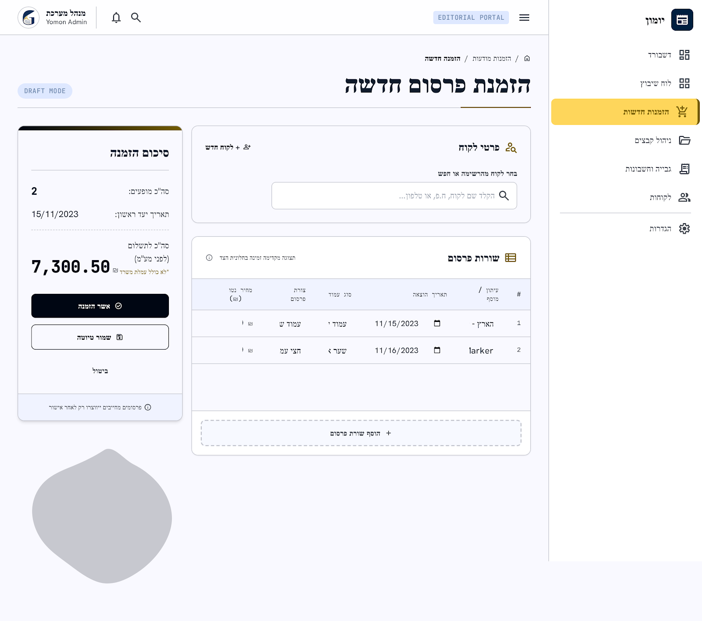

# מסך 03 — הזמנת פרסום חדשה

|             |                                                              |
| ----------- | ------------------------------------------------------------ |
| **נכסים**   | `../assets/03-new-order.png` · `../assets/03-new-order.html` |
| **נתיב**    | `new-orders`                                                 |
| **מכסה**    | US-003, US-004 (חלקית), FR-3, FR-17                          |
| **תפקידים** | Sales, Admin                                                 |

---

## מבנה

Breadcrumb (`🏠 / הזמנות מודעות / הזמנה חדשה`), כותרת `הזמנת פרסום חדשה` ב-`headline-lg` עם קו תחתון זהב, ובצד שמאל צ'יפ `DRAFT MODE` ב-`label-sm`.

### עמודה ימנית (רחבה) — שני כרטיסים

**פרטי לקוח** — כותרת עם אייקון `person_search`, קישור `+ לקוח חדש` בקצה, ושדה חיפוש: `הקלד שם לקוח, ח.פ, או טלפון…`.

**שורות פרסום** — כותרת עם אייקון, והערה `תצוגה מקדימה זמינה בחלונית הצד`. טבלה עם עמודות:

`#` · **עיתון / מוסף** · **תאריך הוצאה** · **סוג עמוד** · **צורת פרסום** · **מחיר נטו (₪)**

כל תא הוא input inline (dropdown / date picker / currency). מתחת לטבלה — כפתור מקווקו ברוחב מלא: **`+ הוסף שורת פרסום`**.

### עמודה שמאלית (צרה, דביקה) — "סיכום הזמנה"

כרטיס עם פס זהב עליון:

| שדה                     | ערך          |
| ----------------------- | ------------ |
| סה״כ מופעים             | 2            |
| תאריך יעד ראשון         | 15/11/2023   |
| סה״כ לתשלום (לפני מע״מ) | **7,300.50** |

הסכום ב-`display-lg` מונו. מתחתיו הערת `*לא כולל עמלת משריך`.

כפתורים מוערמים: `✓ אשר הזמנה` (primary) · `שמור טיוטה` (secondary) · `ביטול` (ghost).

בתחתית הכרטיס, על רקע נבדל: **`ⓘ פרסומים מחייבים ייווצרו רק לאחר אישור`** — בדיוק הכלל של US-004/FR-3. ✅

---

## התאמה לדרישות

| דרישה                                    | מצב          |
| ---------------------------------------- | ------------ |
| הזמנה עם פרסום אחד או יותר               | ✅           |
| שמירה כטיוטה בלי ליצור פרסומים           | ✅           |
| הגדרת תאריך, עיתון, גודל ומחיר לכל פרסום | ✅           |
| סכום כולל מחושב                          | ✅           |
| הבהרה שפרסומים נוצרים רק לאחר אישור      | ✅           |
| **תצוגה מקדימה של הפרסומים שייווצרו**    | ❌ ראה פערים |

---

## רעש של Stitch — לא לממש

| בעיצוב                    | במקום זה                                                         |
| ------------------------- | ---------------------------------------------------------------- |
| `סה״כ לתשלום (לפני מע״מ)` | `AdOrder.total_price` הוא סכום יחיד — התווית נעשית `סה״כ לתשלום` |
| `*לא כולל עמלת משריך`     | לא קיים באפיון — ההערה יורדת                                     |
| `ח.פ` בחיפוש הלקוח        | החיפוש לפי שם, איש קשר, טלפון או מייל (`Customer` ב-`erd.md`)    |
| `עיתון / מוסף`            | `Newspaper` בלבד — התווית נעשית `עיתון`                          |

## פערים אמיתיים מול האפיון — להשלים

1. **התצוגה המקדימה חסרה.** US-003 דורש במפורש "תצוגה מקדימה של כל הפרסומים שייווצרו מההזמנה". העיצוב כותב "תצוגה מקדימה זמינה בחלונית הצד", אבל חלונית הצד מציגה סיכום מספרי בלבד. צריך לעצב פאנל או מודאל שמציג את N הפרסומים כרשומות נפרדות.
2. **מילוי מחיר אוטומטי.** FR-17: מחיר בסיסי לפי עיתון × סוג עמוד × צורת פרסום. שדה "מחיר נטו" ריק בעיצוב — צריך להראות טעינה מ-`PriceRule` עם אפשרות דריסה ידנית וחיווי כשהמחיר נדרס.
3. **ולידציה ברמת שורה** — תאריך בעבר, או צורת פרסום שאינה מותרת לסוג העמוד לפי `AllowedAdShape`.
4. **מסכים נלווים חסרים** (יעוצבו בהמשך — ראה [`../gaps.md`](../gaps.md) §ג): רשימת הזמנות, ומסך אישור/דחייה עם שדה סיבת דחייה (US-004, FR-19).
