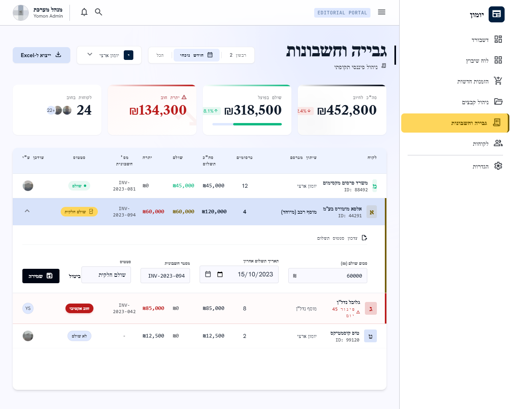

# מסך 04 — גבייה וחשבונות

|             |                                                          |
| ----------- | -------------------------------------------------------- |
| **נכסים**   | `../assets/04-billing.png` · `../assets/04-billing.html` |
| **נתיב**    | `billing`                                                |
| **מכסה**    | US-010, FR-7                                             |
| **תפקידים** | Accounting, Admin (**לא** Designer — FR-8)               |

---

## מבנה

כותרת `גבייה וחשבונות` + תת-כותרת `ניהול פיננסי תקופתי`.

סרגל מסננים: בורר תקופה כ-segmented control (`רבעון 2` / `חודש נוכחי` / `הכל`), dropdown עיתון (`יומן ארצי`), וכפתור `ייצוא ל-Excel` (primary, אייקון download).

### ארבעה כרטיסי סיכום

| תווית       | ערך      | סגנון                              |
| ----------- | -------- | ---------------------------------- |
| סה״כ לחיוב  | ₪452,800 | ניטרלי + צ'יפ מגמה `2.4%↓`         |
| שולם בפועל  | ₪318,500 | ירוק + צ'יפ `8.1%↑` + פס התקדמות   |
| יתרת חוב    | ₪134,300 | **error**, גבול אדום, אייקון אזהרה |
| לקוחות בחוב | 24       | ניטרלי + ערימת אווטארים `+22`      |

### טבלה

עמודות: **לקוח** (אווטאר + שם + `ID: 88492` במונו) · **עיתון מפרסם** · **פרסומים** · **סה״כ תשלום** · **שולם** (ירוק) · **יתרה** (אדום אם > 0) · **מס׳ חשבונית** (מונו, `INV-2023-081`) · **סטטוס** · **עודכן ע״י** (אווטאר)

שורות חוב מקבלות פס אדום בצד ורקע אדמדם. שורה אחת מציגה `⚠ פיגור 45 יום`.

### עריכה inline

לחיצה על שורה פותחת אזור עריכה מתחתיה עם כותרת `✎ עדכון סטטוס תשלום` וארבעה שדות בשורה:

`סכום שולם (₪)` · `תאריך תשלום אחרון` · `מספר חשבונית` · `סטטוס`

ולידם כפתור `שמירה` (primary) ו-`ביטול` (ghost).

**זהו בדיוק מה ש-US-010 דורש** — עדכון ידני של סטטוס תשלום, סכום, תאריך ומספר חשבונית חיצונית. ✅

---

## התאמה לדרישות

| דרישה                                         | מצב                                |
| --------------------------------------------- | ---------------------------------- |
| דוח לפי עיתון או כל העיתונים                  | ✅                                 |
| עדכון ידני של סטטוס, סכום, תאריך, מס׳ חשבונית | ✅                                 |
| שמירת שם המשתמש והתאריך של כל שינוי           | ✅ עמודת "עודכן ע״י"               |
| ללא הפקת חשבונית אוטומטית (FR-7)              | ✅ מספר חשבונית הוא שדה טקסט חופשי |
| **דוח שבועי או חודשי**                        | ⚠️ יש רבעון/חודש/הכל — אין שבועי   |
| **מי מפרסם, למי חסרה מודעה, מי לא שובץ**      | ❌ המסך פיננסי בלבד                |

---

## רעש של Stitch — לא לממש

| בעיצוב                         | במקום זה                                                       |
| ------------------------------ | -------------------------------------------------------------- |
| `חוב אקטיבי`, `⚠ פיגור 45 יום` | ה-enum הוא `unpaid / partially_paid / paid / debt` בלבד (FR-7) |
| `ID: 88492`                    | ה-id הוא מזהה טכני ולא מוצג למשתמש                             |
| `ייצוא ל-Excel`                | לא בדרישות MVP                                                 |
| צ'יפי מגמה (`8.1%↑`, `2.4%↓`)  | דורשים השוואה לתקופה קודמת שלא נדרשת באפיון                    |

## פערים אמיתיים מול האפיון — להשלים

1. **הדוח לא מכסה את US-010 במלואו.** הדרישה: "הדוח מציג מי מפרסם בתקופה, למי חסרה מודעה, מי לא שובץ ומי חייב כסף", ו-"לכל פרסום סטטוס פרסום, סטטוס שיבוץ וסטטוס תשלום". המסך הנוכחי פיננסי בלבד ומקובץ לפי לקוח, לא לפי פרסום. צריך טאב "דוח פרסומים" נוסף, או הרחבת הטבלה לרמת פרסום.
2. **חסרה תקופה "שבועי".** US-010 דורש דוח שבועי או חודשי; בבורר יש רבעון/חודש/הכל.
3. **רמת האגרגציה לא מוגדרת.** ב-`erd.md` `Payment` היא רשומה עצמאית (`amount`, `payment_date`, `status`) שיכולה להיות משויכת להזמנה אחת. העיצוב מציג שורה מצטברת אחת ללקוח. צריך להגדיר: שורה = לקוח? לקוח × עיתון? הזמנה?
4. **אין היסטוריית תשלומים.** לקוח ב-`partially_paid` שילם בכמה פעימות — צריך מקום לראות את רשומות ה-`Payment` הבודדות.
