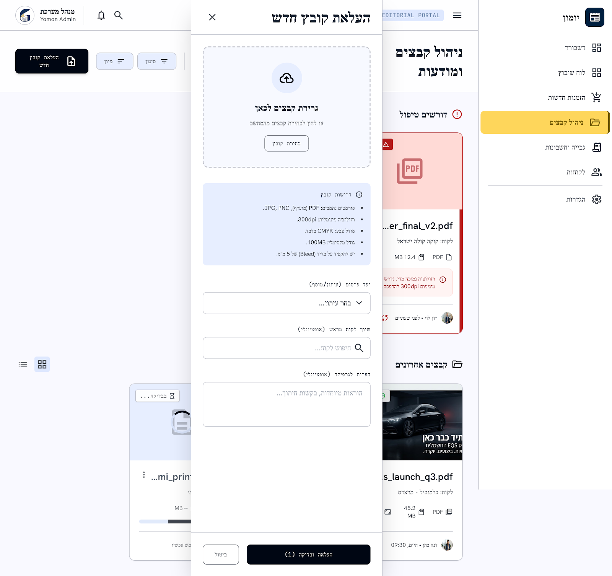

# מסך 05 — ניהול קבצים ומודעות

|             |                                                                          |
| ----------- | ------------------------------------------------------------------------ |
| **נכסים**   | `../assets/05-file-management.png` · `../assets/05-file-management.html` |
| **נתיב**    | `file-management`                                                        |
| **מכסה**    | US-005, FR-15, FR-21                                                     |
| **תפקידים** | Sales, Designer, Admin                                                   |

---

## מבנה

כותרת `ניהול קבצים ומודעות` ב-`headline-lg`. בצד שמאל: `סינון`, `מיון`, ו-`העלאת קובץ חדש` (primary, אייקון upload). מתג תצוגה גריד/רשימה.

### סקשן "דורשים טיפול" (עליון)

כותרת עם אייקון `error` אדום. כרטיסי קבצים בעייתיים — **גבול אדום + פס אדום בצד**. כל כרטיס:

- תמונה ממוזערת (אייקון PDF אדום כשאין תצוגה מקדימה) + badge אזהרה בפינה
- שם קובץ (`...er_final_v2.pdf`)
- `לקוח: קוקה קולה ישראל`
- מטא-דאטה במונו: `PDF` · `12.4 MB`
- **באנר שגיאה אדום בתוך הכרטיס:** `ⓘ רזולוציה נמוכה מדי. נדרש מינימום 300dpi להדפסה.`
- תחתית: אווטאר `רון לוי` · `לפני שעתיים`

תואם ל-US-005: קובץ פגום מציג הודעת שגיאה ואינו זמין לשיבוץ. ✅

### סקשן "קבצים אחרונים"

אותו כרטיס במצב תקין — badge ירוק, גבול רגיל. דוגמאות: מודעת מרצדס EQS (`s_launch_q3.pdf`, 45.2 MB), וקובץ בסטטוס `בבדיקה…` עם פס התקדמות ("מעבד עכשיו").

### פאנל העלאה (נפתח מהצד, ~500px)

כותרת `העלאת קובץ חדש` + `✕`.

1. **אזור גרירה** — מקווקו, אייקון `cloud_upload` בעיגול, `גרירת קבצים לכאן`, `או לחץ לבחירת קבצים מהמחשב`, כפתור `בחירת קובץ`
2. **כרטיס דרישות** (רקע תכלת, אייקון `info`) — `דרישות קובץ`:
   - פורמטים נתמכים: PDF (מועדף), JPG, PNG
   - רזולוציה מינימלית: 300dpi
   - מודל צבע: CMYK בלבד
   - גודל מקסימלי: 100MB
   - יש להקפיד על בליד (Bleed) של 5 מ״מ
3. `יעד פרסום (עיתון/מוסף)` — dropdown
4. `שיוך לקוח מראש (אופציונלי)` — חיפוש
5. `הערות לגרפיקה (אופציונלי)` — textarea
6. תחתית דביקה: `העלאה ובדיקה (1)` (primary) + `ביטול`

---

## התאמה לדרישות

| דרישה                                      | מצב                                    |
| ------------------------------------------ | -------------------------------------- |
| העלאת PDF / JPG / PNG                      | ✅                                     |
| הודעת שגיאה על קובץ פגום/חורג              | ✅ מצוין                               |
| הצגת סוג, גודל, תצוגה מקדימה, מי העלה ומתי | ✅ הכל קיים                            |
| **מודעה ללא לקוח אינה זמינה לשיבוץ**       | ⚠️ השיוך מסומן "אופציונלי" — ראה פערים |
| **שמירת גרסה קודמת אחת**                   | ❌ אין ייצוג                           |

---

## רעש של Stitch — לא לממש

כרטיס "דרישות קובץ" הוא **רכיב טוב עם תוכן מומצא**. הרכיב נשאר, חמש השורות מוחלפות:

| בעיצוב                                  | במקום זה                                                                |
| --------------------------------------- | ----------------------------------------------------------------------- |
| `רזולוציה מינימלית: 300dpi`             | אין ולידציית dpi ב-MVP — יורד                                           |
| `מודל צבע: CMYK בלבד`                   | אין שדה צבע — יורד                                                      |
| `יש להקפיד על בליד (Bleed) של 5 מ״מ`    | אין שדה bleed — יורד                                                    |
| `גודל מקסימלי: 100MB`                   | `Newspaper.max_ad_file_size` — **נטען דינמית לפי העיתון שנבחר** (FR-21) |
| `פורמטים נתמכים: PDF (מועדף), JPG, PNG` | ✅ נשאר — תואם ל-US-005                                                 |

כמו כן: `יעד פרסום (עיתון/מוסף)` → `עיתון` בלבד; `הערות לגרפיקה` → אין שדה כזה ב-`Advertisement`, יורד.

> באנר השגיאה בכרטיס הקובץ (`רזולוציה נמוכה מדי…`) הוא **דפוס מצוין** — נשאר, אבל התוכן יהיה שגיאה אמיתית מ-`Advertisement.validation_error`: קובץ פגום, חורג מהגודל שהוגדר לעיתון, או לא ניתן לפתיחה.

## פערים אמיתיים מול האפיון — להשלים

1. **שיוך לקוח מסומן "אופציונלי" בלבד.** נכון טכנית (`Advertisement.customer_id` אופציונלי), אבל US-005 קובע שמודעה ללא לקוח **אינה זמינה לשיבוץ**. צריך badge `ללא לקוח` בולט על הכרטיס וכפתור `שייך ללקוח`.
2. **אין ניהול גרסאות.** US-005: "כאשר קובץ מודעה מוחלף, המערכת שומרת גרסה קודמת אחת בלבד" (`previous_file_url`). צריך זרימת החלפת קובץ וצפייה בגרסה הקודמת.
3. **היקף הוולידציה לא מוגדר.** סטטוס "בבדיקה" תואם ל-`validation_status = pending`, אבל צריך להחליט מה נבדק בפועל ב-MVP — לפי US-005: קובץ פגום, חורג מהמותר לעיתון, או שלא ניתן לפתיחה.
4. **אין קישור לפרסומים.** מודעה אחת יכולה לשמש כמה פרסומים; אין דרך לראות באילו.
5. **אין מצב ריק** לעסק בלי קבצים.
