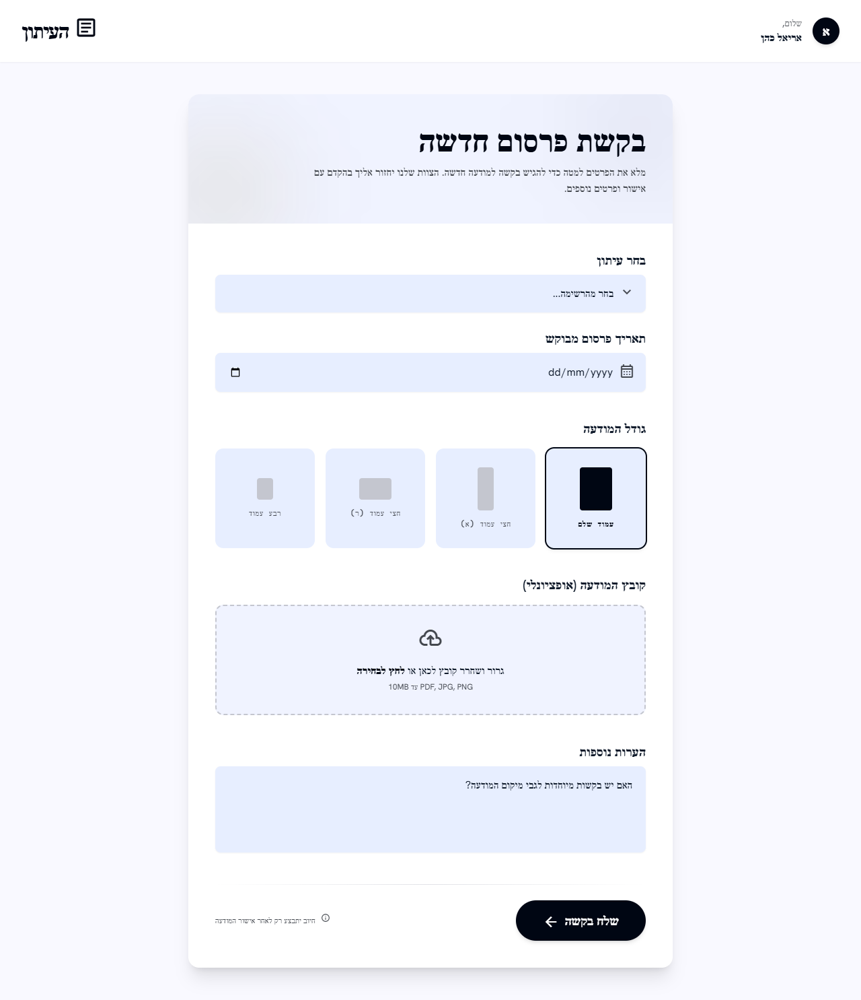

# מסך 06 — פורטל לקוח: בקשת פרסום חדשה

|             |                                                                        |
| ----------- | ---------------------------------------------------------------------- |
| **נכסים**   | `../assets/06-portal-request.png` · `../assets/06-portal-request.html` |
| **מכסה**    | US-009, FR-9, FR-18                                                    |
| **תפקידים** | Customer בלבד                                                          |

**מעטפת שונה לחלוטין מהכלים הפנימיים** — ראה `../app-shell.md` §4.

---

## מבנה

פס עליון דק: מימין אייקון `article` + **העיתון**; משמאל `שלום, אריאל כהן` + אווטאר.

כרטיס יחיד ממורכז (~720px, רדיוס `xl`):

**ראש הכרטיס** (רקע גרדיאנט תכלת עדין):

- `בקשת פרסום חדשה` ב-`headline-lg`
- `מלא את הפרטים למטה כדי להגיש בקשה למודעה חדשה. הצוות שלנו יחזור אליך בהקדם עם אישור ופרטים נוספים.`

**גוף הטופס** (שדות מוערמים, מרווחים נדיבים, תוויות bold מעל כל שדה):

| שדה                     | סוג              | הערות                                                            |
| ----------------------- | ---------------- | ---------------------------------------------------------------- |
| בחר עיתון               | dropdown         | `בחר מהרשימה…`                                                   |
| תאריך פרסום מבוקש       | date picker      | **תאריך יחיד** — תואם ל-US-009 ✅                                |
| גודל המודעה             | 4 כרטיסים נבחרים | `עמוד שלם` (נבחר) · `חצי עמוד (א)` · `חצי עמוד (ר)` · `רבע עמוד` |
| קובץ המודעה (אופציונלי) | אזור גרירה       | `PDF, JPG, PNG עד 10MB`                                          |
| הערות נוספות            | textarea         | `האם יש בקשות מיוחדות לגבי מיקום המודעה?`                        |

**בורר גודל המודעה** — כל כרטיס מציג מלבן אפור בפרופורציה של הצורה בפועל, עם התווית מתחתיו. הנבחר בגבול כהה ומלבן שחור. פתרון מצוין: הלקוח רואה את היחס ולא רק שם.

**תחתית:** `שלח בקשה →` (primary), ולידו `ⓘ חיוב יתבצע רק לאחר אישור המודעה`.

---

## התאמה לדרישות

| דרישה                                 | מצב       |
| ------------------------------------- | --------- |
| בחירת עיתון                           | ✅        |
| **תאריך פרסום אחד בלבד** (US-009)     | ✅        |
| בחירת גודל פרסום                      | ✅        |
| העלאת PDF / JPG / PNG                 | ✅        |
| הבהרה שהבקשה טעונה אישור              | ✅ פעמיים |
| לקוח לא רואה מידע תשלום (FR-9, FR-18) | ✅        |

התאמה טובה מאוד לאפיון — המסך הכי "נקי" מבין השישה.

---

## רעש של Stitch — לא לממש

| בעיצוב                                    | במקום זה                                                                                                   |
| ----------------------------------------- | ---------------------------------------------------------------------------------------------------------- |
| `PDF, JPG, PNG עד 10MB`                   | `Newspaper.max_ad_file_size` של העיתון שנבחר (FR-21). שים לב שהמסך הפנימי אומר 100MB — שני המספרים אקראיים |
| `האם יש בקשות מיוחדות לגבי מיקום המודעה?` | אין בקשת מיקום באפיון. אם רוצים textarea כללי — שדה הערות חופשי, בלי הבטחה על מיקום                        |
| `ⓘ חיוב יתבצע רק לאחר אישור המודעה`       | FR-9: לקוח אינו רואה מידע תשלום ב-MVP. לנסח: `הבקשה תהפוך לפרסום מחייב רק לאחר אישור`                      |

## פערים אמיתיים מול האפיון — להשלים

1. **בורר הגדלים קשיח.** US-009: הלקוח בוחר רק עיתון, תאריך וגודל **הזמינים לפי הגדרות העסק**. ארבעת הכרטיסים חייבים להיטען מ-`AllowedAdShape` של העיתון שנבחר ולהתרענן בהחלפת עיתון. הרכיב עצמו (מלבן בפרופורציה + תווית) נשאר — רק המקור דינמי.
2. **הקובץ מסומן "אופציונלי"** — לא סותר את האפיון, אבל בקשה בלי קובץ תיצור פרסום ב-`missing_ad`. כדאי להבהיר ללקוח שיידרש להעלות חומר בהמשך.
3. **אין אישור שליחה** — מה קורה אחרי "שלח בקשה"? צריך מסך או מצב אישור שמסביר שהבקשה נשמרה כ-`pending_approval`.
4. **אין ולידציה** — שדות חובה, תאריך בעבר, קובץ חורג מהגודל.
5. **מסכי פורטל חסרים** (יעוצבו בהמשך — ראה [`../gaps.md`](../gaps.md) §ג): התחברות, רשימת בקשות עם סטטוסים, ותצוגת בקשה שנדחתה עם סיבת הדחייה (FR-19).
